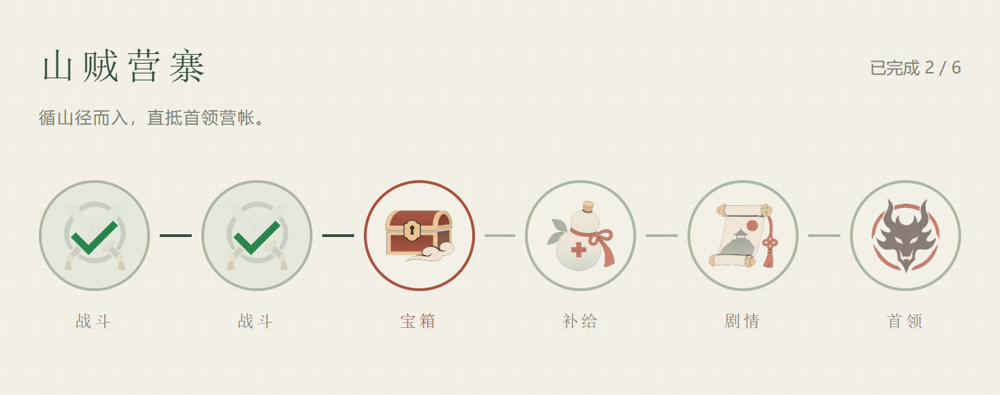

# 地下城节点流程与 UI 需求

版本：v0.1 · 日期：2026-11-05 · 状态：需求与资源交付，待实施。

## 1. 目标与边界

从地图入口进入地下城，根据配置生成节点和连接线，依次执行战斗、宝箱、补给、对话、CG 等内容，支持分叉与汇合。玩家选择路线，完成当前遭遇后再选择下一处，退出重进可继续。

复用已有地图事件、战斗、对话、CG、奖励、UI 管理和存档能力。实施前核对现有代码和配置，只补必要结构，不创建平行系统。此文定义通用最小能力，不要求一次配置完整首领四阶段或新增商店等业务。

## 2. UI 定稿

- 使用用户选择的第二套「简约平涂」图标。纸面、字体、色调沿用现有水墨 UI。
- 节点从左向右排列，以正常正圆承载图标，节点之间使用短线连接。直线是示例，不得将数量、顺序、连接关系写死。
- 图标适当缩小、视觉居中；不是将整张图集单元直接按矩形居中。每种图标允许设置独立尺寸和位置偏移。
- 已完成节点覆盖半透明浅色蒙层和醒目绿色 √，保留原图标可辨识性。
- 当前可进入节点只把原圆边框改为朱红，不添加第二层外圈。分叉后多个可选节点都采用该状态。
- 后续不可进入节点保持普通边框，图标可适当淡化；已关闭的路线与已完成节点区分，不能打 √。
- 不展示节点详情面板，不提供“开始/进入”二次按钮，不放“完成覆 √／朱红边框”等状态说明文字。节点下方保留简短类型名称。
- 点击可进入节点，直接执行该节点；点击不可进入或已完成节点不执行业务。不能因点击穿透发起地图移动。
- 标题和已完成数量从配置与进度生成。参考截图中的文字、六节点排列和宝箱当前状态均为示例。

分叉向上下展开，汇合后继续向右；整体仍横向推进。本包含线性定稿截图和分叉布局示意，分叉示意仅验证排布，不能代替运行验收。

## 3. 配置结构

将“固定步骤数组”扩展成“带连接关系的节点集合”。节点不嵌套复制整套战斗或对白配置，而是引用已有内容。

| 层级 | 必需信息 | 说明 |
| --- | --- | --- |
| 地下城 | dungeonId、名称、startNodeId、节点集合 | 稳定 ID，入口必须存在 |
| 节点 | nodeId、节点类型、执行内容引用、nextNodeIds | 后续 ID 数组表达分叉与汇合 |
| 展示 | 图标引用、简短名称、排序顺序 | 图标默认按类型映射，允许配置覆盖 |

优先使用已有流程 ID 作为执行内容引用。只有现有流程契约不适用时才采用类型＋事件 ID，不能同时维护两套重复定义。参考 [配置样例](../../../UI/Dungeon/v02/Data/dungeon-example.json) 的字段供映射，不强制改写工程命名和目录。

- 一个后续 ID：直线；多个后续 ID：分叉；不同节点指向同一后续节点：汇合；空数组：终点，成功完成后提交地下城完成结果。
- 首版使用有向无环图，不做循环、回头路、随机生成、隐藏路线或复杂条件表达式。
- 所有路径从入口可达，并最终通往终点。缺失引用、重复 ID、循环、不可达节点、无效内容引用应报告配置错误，不能运行到一半才无响应。
- 节点 ID 保持稳定。已发布内容改名/删节点可能影响旧档，需明确兼容；不能静默清空玩家进度。

## 4. 分叉、汇合和执行规则

1. 进入地下城时，无进度则入口节点可进入；有进度则恢复当前遭遇或最后完成节点对应的后续选项。
2. 当前节点成功结束后，开放其 nextNodeIds。其他节点不能跳着进入。
3. 多个后续节点可选时，点击其中一个即锁定该次选择；其他同级选项关闭，战败重试不允许借机改路。
4. 路线选择关闭的是不再可达的分支，不是将这些节点标成已完成；后面仍可汇合到共同节点。
5. 同时只执行一个节点。处理遭遇期间禁用其他节点，拦截重复点击，不允许多开战斗、CG 或奖励结算。
6. 战斗胜利才完成；失败或撤退不推进，沿用工程规则重试当前节点。无既有规则时恢复当前战斗开始前快照重试，不在本轮扩建复活机制。
7. 宝箱发奖、补给回血等业务成功结算才完成。对话/CG 的正常结束或受支持的跳过都走统一结果提交，窗口关闭不自动视为成功。
8. 节点结算、完成标记和奖励防重属于同一一致结果，重复回调、重进或读档不能重复领奖、刷补给。
9. 节点成功结束后回到地下城节点图，更新蒙层与可选边框；玩家点击下一个节点继续，不自动串开另一场遭遇。
10. 完成终点后提交一次地下城完成结果，返回原地图，由地图事件/任务处理后续。不在 UI 中写死“山贼主线完成”。

## 5. 布局与状态生成

节点位置按图关系生成。建议以拓扑层级确定横向列：节点列号为所有前驱列号最大值＋1；同列按稳定配置顺序排列，上下分流，尽量减少交叉。汇合节点在前驱右侧，不能被画到其前面。

节点大小、水平间距、分叉行距、图标映射及图标偏移集中配置。图标不含程序边框，正圆、连线、蒙层与 √ 由 UI 组件生成。

节点多时在独立路线容器中平移/滚动，不无限缩小图标，也不折行造成连接歧义；复用工程已有手势与输入保护。打开或恢复时确保当前遭遇/可选节点可见。选中多分支时尽量同时容纳可选项。

业务状态至少区分已完成、可进入、执行中、后续未开放、路线已关闭。红边体现可进入/当前执行目标，不承担业务判断；类型图标与状态独立。

## 6. 保存与退出

持久进度至少包含地下城 ID、当前执行节点（若有）、最后完成节点、已完成 ID 集合、已选择路线和地下城完成状态。配置文件不被运行时修改；可进入集合由配置和进度推导。

节点之间属于地下城安全状态，应允许必要存档，不要求玩家先退回世界地图。若现有“仅地图空闲可保存”限制挡住此状态，只补充地下城节点间的安全边界；仍禁止战斗、CG、对话执行中存读。

每个节点成功结算、图恢复稳定后可提交自动保存；锁定分支选择后、启动遭遇前也需保留该选择及安全的重试信息，避免退出后重新选路。保存服务统一写入，不为地下城另建文件。错误不能导致奖励和完成进度一半成功。

节点图空闲时，使用既有返回/Esc 和 UI 归属规则暂离，返回原地图可达安全落点，保留路线与已完成节点。再次进入从进度继续；遭遇进行中不能从节点图绕开退出限制。地图场景保留/重载与返回落点遵循已有工程约定。

本轮不做战斗回合、CG 时间点或对白句内续播；流程中退出游戏，恢复到该遭遇的安全重试状态，不能保留未提交的部分奖励或消耗。存档最终验收由用户负责，实施方仍需完成本功能接线和必要自检。

## 7. 首轮实施与验收

先核对现有结构并完成最小配置适配，再用：

**入口对话 → 两条可选测试战斗 → 汇合补给 → 结束。**

复用已有测试战斗和通用对话，不新增正式剧情或敌群制作任务。线性 UI 的宝箱/书信等仅演示不同类型，并非要求本轮同时开发所有业务模块。类型没有执行能力时明确报错，不显示为可正常体验的假入口。

验收要点：

- 修改配置能改变节点数量、类型、直线/分叉/汇合关系，UI 无需逐节点改代码；错误配置有可定位提示。
- 多个可选节点均为朱红单边框；点击其中一个直接启动一次内容，关闭的分支不能进入；失败只重试所选节点。
- 战斗结果写回真实气血和消耗；补给、奖励及完成结果不重复。成功回图后显示绿色 √，下一节点可进入。
- 采用第二版简约平涂图标，正圆、图标视觉居中，无详情和额外进入按钮；不同路线规模下无图标重叠、连线穿过其他节点或输入穿透。
- 退出重进正确恢复路线，终点完成只回传一次结果。给用户留下可操作的存档验收入口。
- 提供实际运行截图/短视频、变更与配置说明、自检结果和未解决项，不以浏览器预览替代 Unity 运行验收。

本包未包含 Unity 运行时代码、Prefab、.meta 或字体。上传或远程实施需后续明确指令，本次不自动执行。
