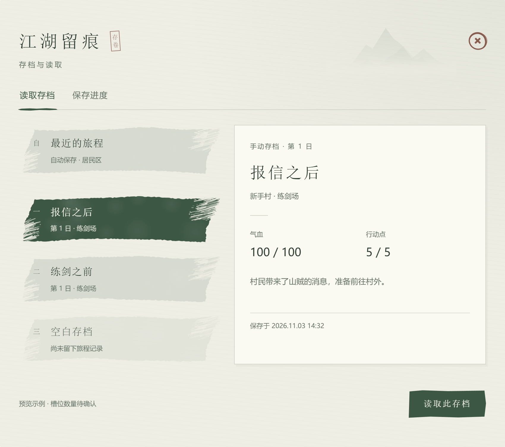

# 存档系统需求方案（含 UI）

版本：v0.1  
日期：2026-11-04  
状态：待评审需求稿；本次只整理需求，不启动工程改造、上传仓库或远程执行。

## 1. 目标与范围

玩家可以在地图探索的安全时机保存进度，退出游戏后读取，恢复到保存时的地图、角色位置、物品、任务和事件状态，方便逐步验证 Demo。

复用工程已有存档、地图、任务、背包、角色和 UI 管理能力，先检查缺口再补齐，不另建一套平行系统。UI 使用已确认的极简水墨版本，将美术预览接成真实功能。

首版支持本地存档、手动保存、读取、自动保存、覆盖确认和必要的失败提示。不包含云同步、多账号、跨设备传输、战斗中途恢复、对话句内恢复、CG 时间点恢复，以及存档编辑器。

## 2. 本稿采用的规则

| 项目 | 规则 | 确认程度 |
| --- | --- | --- |
| UI 风格 | 使用当前水墨定稿和已拆分资源 | 已确认视觉方向 |
| 自动档顺序 | 自动存档位在最上方 | 已确认 |
| 进度恢复 | 恢复角色、地图及已完成事件，完成内容不重复触发 | 沿用前述需求 |
| 存读时机 | 地图空闲时允许操作；移动、流程执行、切图及存读期间禁止 | 本稿建议 |
| 自动保存 | 一整条地图事件流程成功结束、状态稳定后更新 | 本稿建议 |
| 槽位数量 | 自动档独立；手动槽位数量由统一配置决定，预览中的 3 个仅为示例 | 已确认按配置生成 |
| 存档名称 | 自动生成地点/游戏日名称，手动档允许编辑，最多 18 个字符 | 本稿建议 |
| 删除 | 首版不增加删除入口；手动档通过覆盖更新 | 本稿建议 |

上述建议用于把方案写完整，评审时可调整。未经实施验证的美术预览行为不能作为功能已完成的依据。

## 3. UI 效果与资源

### 3.1 完整界面

### 3.2 二次确认

图片是已定稿的浏览器预览，文字和数值为示例，不代表 Unity 已完成。实际按钮文案和状态以本稿规则为准。

沿用宣纸背景、灰绿/浓绿存档笔刷、干净纸面详情区和不规则笔触按钮。存档笔刷左下与右上飞白长度为 4:6，两侧同向斜切，轮廓保留自然起伏。取消按钮与确认按钮使用同类笔触，取消用浅色。返回为朱圈和短粗 ×，与左侧标题中心对齐。不得恢复为规整矩形边框。

自动档置顶，手动档依次排列。左右两栏间距采用最近调整的 27 个预览单位，随整体画布缩放；历史参考图和资源包布局若有旧间距，以此条为准，其余宽高比例、颜色与笔触沿用定稿。

资源入口：

- [美术资源包说明](../../../UI/SaveLoad/v01/README.md)
- [资源导入与布局](../../../UI/SaveLoad/v01/Documentation/资源导入与布局.md)
- [PNG 清单](../../../UI/SaveLoad/v01/Assets/WuxiaVillage/Art/UI/SaveLoad/manifest_save_load.json)
- [参考布局参数](../../../UI/SaveLoad/v01/Data/save_load_layout.json)
- 本包已包含完整美术目录 `UI/SaveLoad/v01`，无需另行下载美术 ZIP。

使用独立图片和程序文字组装，不把整张预览图贴成界面。字体复用工程已有中文字体，图片不包含字体授权或运行时 Prefab。正式尺寸与适配遵循工程 CanvasScaler 和 UI 栈约定，并在 Unity 验证。

### 3.3 入口与布局

- 游戏内暂停/菜单提供“保存”“读取”入口，分别打开对应 Tab。
- 标题页提供“读取存档”入口；没有游戏会话时不允许保存。
- 左侧为固定显示区域的槽位列表，右侧为所选存档的详情，底部为主操作按钮。手动槽位超出显示区域时仅手动列表滚动，不挤压详情区或推动底部按钮；自动档独立固定在列表顶部，不计入手动槽位数量。
- 返回关闭当前窗口；存在确认弹窗时，返回先关闭弹窗，不穿透到地图。
- 打开列表只读取摘要，不提前切图或改变游戏状态。默认选中最近的有效存档；无有效存档时选中第一个手动空槽。

### 槽位配置与已有存档

- 手动槽位数量集中配置为正整数，UI 按配置生成条目，不在界面、存档服务或文件命名中写死为 3 个。非法配置应明确报错，不能静默裁减或删除已有存档。
- 增加数量时，新增的槽位显示为空槽；现有存档及其稳定槽位 ID 不变。
- 减少数量时，不删除、不改名、不重编号已有存档。配置范围以外已有的手动档仍在列表中显示，标注“历史存档”，可查看、读取，但不可覆盖；范围以外的空槽不展示。恢复配置数量后，对应槽位恢复正常保存能力。
- 配置决定可写的手动槽位范围，不按本次列表索引定位存档，避免排序或数量变化导致串档。配置修改在下次打开窗口时生效，不在确认或存读操作中途重建列表。
- 自动档使用独立稳定 ID，手动数量调整不能改变其位置、文件或自动保存行为。

### 3.4 显示字段

列表显示自动/手动类型、手动位编号、名称、游戏日或地点等简要信息。自动档单独标注，不能伪装成手动位。

详情显示名称、类型、地点、游戏日、气血、行动点、简述及实际保存时间。字段映射到工程真实数据；若工程没有相应字段，不制造虚假的固定数值，评审后隐藏或替换。简述由进度生成，首版不另加备注编辑器。

保存模式中的名称输入只改变待保存名称，不立即修改旧档。时间格式统一，使用本地时间显示；内部时间保存明确时区的时间戳。游玩时长可作为附加摘要，不作为首版阻塞项。

### 3.5 状态与操作

| 状态 | 读取模式 | 保存模式 |
| --- | --- | --- |
| 有效手动档 | 选择后可“读取此存档” | 可编辑名称并“覆盖此存档” |
| 配置范围外的历史手动档 | 可查看、读取，显示“历史存档”标记 | 可查看，保存按钮禁用，提示“该槽位超出当前配置范围” |
| 空白手动位 | 显示“尚未落笔”，读取按钮禁用 | 可“保存到此处” |
| 有效自动档 | 可读取 | 可查看，手动保存按钮禁用，提示“自动档由游戏保存” |
| 尚无自动档 | 显示“暂无自动存档”，读取禁用 | 不允许手动写入 |
| 损坏或版本不兼容 | 保留条目并明确原因，不允许直接读取 | 手动位可在明确警告后覆盖；自动位不可手动覆盖 |
| 操作进行中 | 按钮显示“正在读取…”并防重复提交 | 按钮显示“正在保存…”并防重复提交 |

禁用状态要有文字原因，不仅改变颜色。选中状态切换不改变笔刷尺寸和文字位置。弹窗遮罩拦截底层操作，按钮命中区域完整，飞白不应造成无法点击。

### 3.6 二次确认与反馈

- 读取：“从此继续旅程？”说明当前未保存进度将丢失；标题页没有当前进度时不显示这句警告。按钮为“取消 / 确认读取”。
- 覆盖：“覆盖这份存档？”展示目标槽位名称，说明旧进度将被替换。按钮为“取消 / 确认保存”。
- 空槽首次保存沿用定稿确认弹窗：“保存当前旅程？”按钮为“取消 / 确认保存”。
- 取消只关闭弹窗，保留选中槽位及本次输入，不修改文件和游戏状态。
- 保存成功刷新该槽摘要并提示“保存成功”；窗口保留。读取成功关闭存档相关窗口，回到恢复后的地图。
- 失败显示可理解的原因和重试提示，不宣称成功。自动保存使用轻量提示，不弹二次确认；失败提示“自动保存失败，上一份存档仍保留”。

## 4. 保存哪些数据

存档保存一份一致的游戏状态快照。以下为业务契约，实际字段名称与结构复用目标工程约定。

| 数据组 | 必须恢复的内容 |
| --- | --- |
| 文件标识 | 存档格式版本、槽位 ID、自动/手动类型、保存时间 |
| 展示摘要 | 名称、地点、游戏日及 UI 使用的真实摘要 |
| 角色与资源 | 气血、行动点、影响玩法的属性及已有队伍状态 |
| 持有内容 | 道具、货币、卡牌、装备等工程实际存在的状态 |
| 任务与剧情 | 任务进度、剧情变量、条件读取所依赖的标志 |
| 地图探索 | 当前逻辑地图、砖块坐标、朝向，以及已有的揭示/访问记录 |
| 地图事件 | 已完成事件 ID、已领取奖励、宝箱开启及传送解锁等持久状态 |

地图、事件、流程和物品使用稳定 ID 引用配置。资源贴图、CG 文件、对话全文、战斗配置、UI 选中状态、打开的弹窗及运行时对象引用不写入存档。

摘要必须与快照来自同一份状态，不能显示“已完成”却恢复到完成前。派生数据尽量重建，避免同一事实在多个字段互相矛盾。

## 5. 地图事件与自动保存

### 5.1 执行与完成

地图入口根据当前游戏状态判断展示和触发条件；存档服务负责保存和恢复这些状态。图标继续只负责展示，不承担完成判断。

一个事件内的步骤按数组顺序执行，例如 CG → 对话 → 战斗 → 奖励。执行期间禁止存读和其他事件并发启动。奖励结算、任务变化、事件完成标记及入口移除状态必须在同一个一致快照中保存，防止读档后重复领奖或跳过奖励。

事件是否完成以成功结算为准，不以打开窗口、视频被关闭或战斗启动为准。取消、失败和战败的处理沿用对应系统规则，不能提前标记整条流程完成，也不触发本稿的成功自动保存。

### 5.2 保存边界

首版只在一整条事件成功结束、结算完毕、地图及玩家状态稳定后自动保存一次。若流程含传送，等待目标地图和落点准备完毕。连续步骤不能每结束一项就保存；同一结束回调重复到达不能重复结算。

流程执行中退出游戏，下一次读取上一次成功保存的状态，该流程可能需要从头执行。由于本次未保存的奖励和完成记录也同时回退，不得在外部残留一份已经领取的奖励。

此前地图方案提到的“当前步骤进度”可继续作为运行时进度使用；**本稿首版不承诺从中间步骤读档恢复**。若工程已有步骤级持久化，实施前应统一恢复规则，不得混用“中途完成标记”与“流程结束快照”。

### 5.3 读档后刷新

先恢复角色、任务、剧情及事件状态，再重建地图展示，最后开放移动和交互。已完成的一次性内容不重新触发；已开的宝箱、已解锁传送和已移除入口必须保持结果。条件不满足的事件仍按地图原规则处理。

完成初始化后才允许地图就绪类触发检查，先排除已完成事件。不把“读取完成”当作新的到达行为广播两次，也不因读档本身立即覆盖自动档。玩家后续完成新的有效流程时才正常自动保存。

## 6. 系统职责与可靠性

UI 只处理选择、展示、确认和反馈，不直接拼存档文件。存档服务统一提供查询摘要、判断当前能否存读、保存槽位、读取槽位等能力；角色、背包、任务和地图模块提供各自状态的采集与恢复。

手动和自动保存共用同一套状态采集与写入逻辑，统一串行执行。读取确认后再次检查当前状态和目标档有效性，避免确认前后发生变化。

写入时先生成完整快照，再写临时文件，完成校验后替换正式档，并保留上一份有效备份。不能先清空旧档再写入。目标平台不支持原子替换时，采用可恢复的等价方案。写入失败保留旧档，重启时忽略或清理未完成临时文件。

读取先解析、校验版本及必要配置 ID，再执行恢复。失败时不留下半恢复的角色和地图；如果恢复过程可能失败，需要可回退的旧状态或安全的标题页恢复入口。不能将坐标无效或配置缺失静默改成新游戏后覆盖原档。

存档使用工程既有持久化目录，不放到 Assets 或只读安装目录。不新增加密、防篡改和通用迁移平台；保留格式版本号，不兼容旧档时明确提示。若项目已有真实存档，改造前备份并明确兼容方案，禁止直接删除玩家数据。

## 7. Demo 验收

| 场景 | 通过标准 |
| --- | --- |
| 首次启动无存档 | 各槽为空且展示正确；读取禁用，地图空闲时可写手动空槽 |
| 手动保存后重启 | 地图、位置、气血、行动点、物品、任务和剧情状态与保存时一致 |
| 不同手动槽 | 保存两个不同阶段后分别读取，各自正确且互不覆盖 |
| 手动数量配置 | 分别配置少量和超出可视区的槽位，数量正确；手动列表可滚动，自动档、详情和按钮保持位置 |
| 配置增减 | 增加后新增空槽；减少后范围外旧档仍可读取但不可覆盖，文件不被删除；恢复数量后原槽位可正常保存，无串档 |
| 自动保存 | 完成一整条事件后自动档更新；手动档不变；自动位始终置顶 |
| 多步骤事件 | 步骤串行；中间不可存读；整条结束后只提交一次自动保存 |
| 流程中退出 | 重启读取上一份完整存档；没有部分奖励或部分完成标记残留 |
| 防重放 | 完成一次性 CG/对话/战斗事件后保存并重启，不重新触发完成内容 |
| 宝箱与传送 | 宝箱奖励不重复领取；传送解锁和地图展示正确恢复 |
| 覆盖及读取取消 | 文件与当前游戏状态不变，返回原选择 |
| 忙碌状态 | 战斗、对话、CG、移动、切图和存读期间无法启动冲突操作，有明确提示 |
| 文件异常 | 损坏、不兼容、写入失败都有反馈；旧有效文件保留；不能显示假成功 |
| 快速重复点击 | 不重复写入、加载、结算或打开多个确认弹窗 |
| UI 还原 | 复用定稿素材，朱圈 ×、笔刷、飞白、取消按钮与确认一致；文字独立，无穿透、溢出或错误缩放 |

优先用“开场前后两个存档＋一个宝箱/奖励事件＋一场战斗＋一个传送点”验证；若 Demo 暂无某类内容，可用最小测试配置补验，不为此扩建业务系统。

## 8. 实施顺序与交付

1. 阅读实际工程的存档格式、状态模型、地图流程及 UI 栈，列出现有能力与缺口，确认历史数据处理方式。
2. 接通统一快照与恢复，先验证一次地图上的保存、重启和读取。
3. 补齐地图事件完成记录、奖励防重、自动保存时机和忙碌限制。
4. 使用现有 14 张独立美术素材组装 Unity UI，绑定槽位、摘要、按钮及确认反馈。
5. 按验收表执行，交付修改说明、运行截图/短视频、检查结果和未解决项。

本稿是实施需求入口，不等于实施授权。当前没有完成 Unity 存档 UI 接入或上述功能验收；后续确认方案并明确通知执行后，再由目标工程实施。

